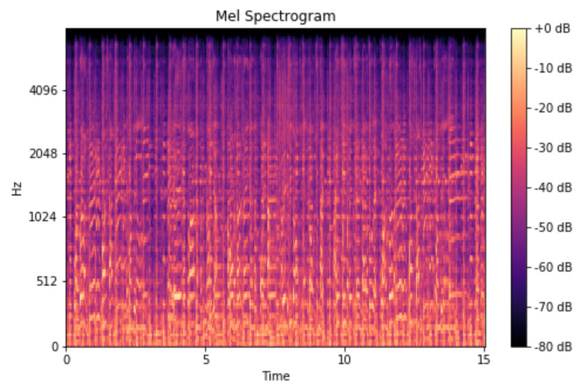
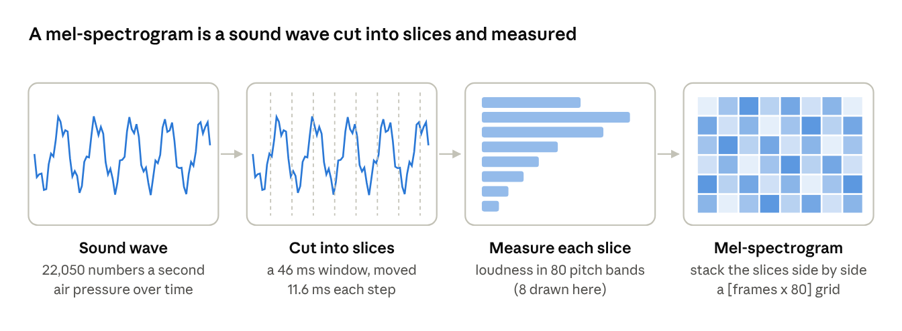
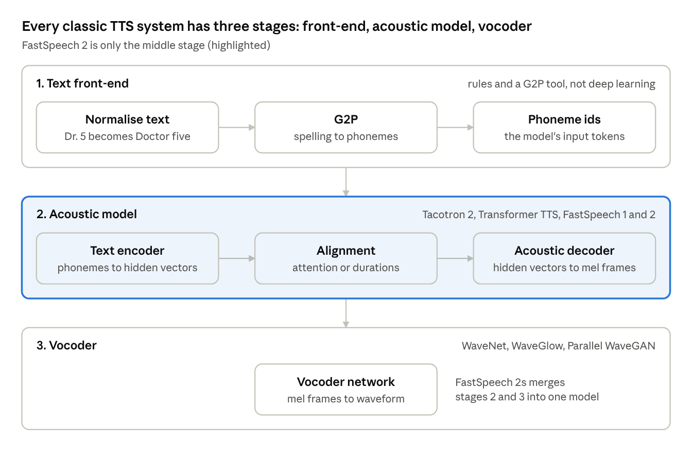
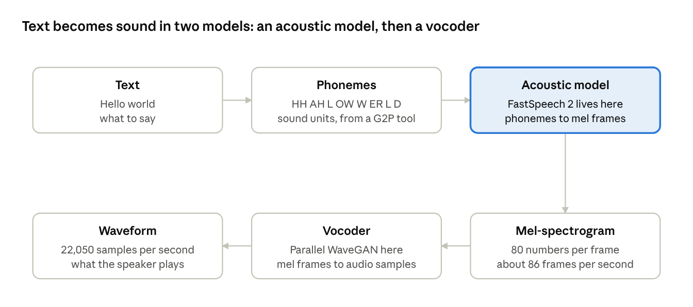

# Text-to-Speech Fundamentals

**Contents**

1. [The Generic TTS Architecture](#1-the-generic-tts-architecture)
2. [The Acoustic Model](#2-the-acoustic-model)
3. [The Three Stages and Their Components](#3-the-three-stages-and-their-components)
4. [Autoregressive and Non-Autoregressive Generation](#4-autoregressive-and-non-autoregressive-generation)

This note covers the general background of neural text-to-speech (TTS). The [FastSpeech 2 notes](03-fastspeech2-non-autoregressive-tts.md) build on it.

---

## 1. The Generic TTS Architecture

**A classic TTS system has three stages in a row: a text front-end that turns writing into phonemes, an acoustic model that turns phonemes into a mel-spectrogram, and a vocoder that turns the mel-spectrogram into sound.** Almost every TTS paper, including this one, improves one of these stages.

The four terms below are used throughout the note.

- **Phoneme.** The smallest unit of sound in a language. "Cat" has 3 phonemes: K, AE, T. "Phone" and "fun" start with the same phoneme (F) despite different spellings. English has about 40 phonemes. The paper's list has 76 symbols because it also counts punctuation and stress marks. **Analogy:** phonemes are to a TTS model what tokens are to a large language model.
- **G2P (grapheme-to-phoneme).** A **grapheme** is a written letter. G2P is a tool that converts spelling into phonemes. This is needed because spelling does not indicate pronunciation ("tough", "though", "through"). It usually looks words up in a pronunciation dictionary and uses a small trained model for words that are not in it. The paper uses an open-source G2P tool.
- **Mel-spectrogram.** A picture of a sound. Time runs left to right, pitch bands run bottom to top, and brightness shows the loudness of each band. The "mel" scale is a pitch scale matched to human hearing. The gap between 100 Hz and 200 Hz is easy to hear, while the gap between 8,000 Hz and 8,100 Hz is not, so the mel scale assigns more bands to low pitches. A mel-spectrogram is much smaller than raw audio: 3 seconds is about 66,000 audio numbers but only 258 × 80 mel numbers. It is made in 4 steps (diagram below).
- **Vocoder.** Short for "voice encoder". A neural network that turns the mel-spectrogram back into a playable sound wave. It must supply detail that the picture discards, namely the **phase** (the exact timing of each wave's peaks). **Analogy:** the mel-spectrogram is sheet music with volume marks and the vocoder is the musician who plays it. Examples are WaveNet and Parallel WaveGAN.

How a mel-spectrogram looks in a real recording:\

How a mel-spectrogram is made:

Each slice becomes one column (one "frame") of the grid. The acoustic model predicts this grid and the vocoder turns it into sound. Section 3 describes each component in more detail.

## 2. The Acoustic Model

The **acoustic model** is the neural network in stage 2. It takes phoneme ids as input and gives a mel-spectrogram as output. "Acoustic" means "about the sound": the output describes how the speech sounds (pitch bands, loudness, timing) and is not the wave itself. It is the part that learns how a voice speaks, so most TTS research happens here, including this paper.

**The acoustic model is defined by its job and not by its architecture.** Any network that maps phonemes to mel frames counts as one. It may or may not be a Transformer.

| Acoustic model | Built from | Generates |
| --- | --- | --- |
| Tacotron 2 | LSTMs (recurrent networks) + attention + convolutions | One frame at a time (autoregressive) |
| Transformer TTS | A full encoder-decoder Transformer, like the original translation Transformer | One frame at a time (autoregressive) |
| FastSpeech 1 and 2 | Transformer-style FFT blocks (self-attention + 1D convolutions), plus small convolutional predictors | All frames at once (non-autoregressive) |

## 3. The Three Stages and Their Components

Generic TTS architecture:

The diagram reads top to bottom. Each stage hands a simpler, more sound-like representation to the next.

- **Stage 1, text front-end.** Mostly rules and lookup tools, with no neural network. It expands numbers and abbreviations ("Dr. 5" becomes "Doctor five"), then a G2P tool turns spelling into phonemes. The output is a list of phoneme ids, like token ids in a language model.
  - **Phonemes.** English spelling is irregular ("though", "tough", "through"), so text is first converted to **phonemes** by a **grapheme-to-phoneme (G2P)** tool. Phonemes act as the model's tokens. The paper's vocabulary is **76 phonemes**, including punctuation.
- **Stage 2, acoustic model.** The neural network that does the main work. It has three jobs:
  - **Encode** the phonemes into hidden vectors, so that each one carries its context (like a Transformer encoder).
  - **Align**: decide which output frames belong to which phoneme. This is the hardest job, because the output is many times longer than the input. Autoregressive models (Tacotron 2, Transformer TTS) learn alignment with attention. FastSpeech models predict a **duration** per phoneme.
  - **Decode** the aligned hidden vectors into mel-spectrogram frames.
  - Extra inputs such as a speaker embedding, an emotion label or (in FastSpeech 2) pitch and energy are usually added between alignment and decoding.
  - **Mel-spectrogram details.** A window of 1,024 samples (about 46 ms) slides along the wave in steps of 256 samples (about 11.6 ms). For each window, the energy at each frequency is measured. The frequencies are then compressed into **80 bands** spaced according to human hearing (the **mel scale**: fine detail at low pitches, coarse at high pitches). The result is a matrix of shape **\[frames × 80\]**.
    - Worked number: 3 seconds = 66,150 samples ÷ 256 ≈ **258 frames**, each an 80-number vector.
    - **Transformer analogy:** each mel frame is like one output token and its 80 numbers are like a small embedding. The acoustic model outputs a sequence of these vectors.
- **Stage 3, vocoder.** A separate network, trained independently, that turns the mel-spectrogram into a waveform.
  - **Waveform.** Sound is air pressure rising and falling. Recorded audio stores it as numbers: **22,050 numbers per second** in this paper (the sample rate). A 3-second sentence is about 66,000 numbers. This is too long and too detailed to predict directly from 20 to 30 phonemes.
  - **Phase.** The mel-spectrogram discards phase (the exact timing of each wave's peaks), so the vocoder has to generate it. The paper uses a pre-trained **Parallel WaveGAN** vocoder.

The stages are separated because each is easier to learn alone, and one stage can be replaced without retraining the others.

**Most TTS systems in 2020 used two separate models: an acoustic model that makes a picture of the sound and a vocoder that turns that picture into audio.**

The classic two-model pipeline:

The diagram reads left to right, then down and back.

## 4. Autoregressive and Non-Autoregressive Generation

This is the most important background idea for the paper.

|  | Autoregressive (AR) | Non-autoregressive (NAR) |
| --- | --- | --- |
| How it outputs | One mel frame at a time, each conditioned on the previous ones | All mel frames in one forward pass |
| Transformer analogy | Like GPT generating text token by token | Like BERT filling every position at once |
| Examples | Tacotron 2, Transformer TTS | FastSpeech, FastSpeech 2 |
| Speed | Slow: 258 frames = 258 sequential steps | Fast: one parallel pass |
| Typical failure | Attention drifts, so words are **skipped or repeated** | Blurry, flat speech (see Section 3 of the [FastSpeech 2 notes](03-fastspeech2-non-autoregressive-tts.md#3-the-one-to-many-problem)) |

A NAR model that outputs everything at once must know **how many frames to make**. 20 phonemes might become 150 frames or 300 frames, depending on speaking speed.

---

## References

- Shen, J., et al. (2018). *Natural TTS Synthesis by Conditioning WaveNet on Mel Spectrogram Predictions* (Tacotron 2). ICASSP 2018. [arXiv:1712.05884](https://arxiv.org/abs/1712.05884)
- Li, N., Liu, S., Liu, Y., Zhao, S., Liu, M., Zhou, M. (2019). *Neural Speech Synthesis with Transformer Network* (Transformer TTS). AAAI 2019. [arXiv:1809.08895](https://arxiv.org/abs/1809.08895)
- van den Oord, A., et al. (2016). *WaveNet: A Generative Model for Raw Audio.* [arXiv:1609.03499](https://arxiv.org/abs/1609.03499)
- Yamamoto, R., Song, E., Kim, J.-M. (2020). *Parallel WaveGAN: A Fast Waveform Generation Model Based on Generative Adversarial Networks with Multi-Resolution Spectrogram.* ICASSP 2020. [arXiv:1910.11480](https://arxiv.org/abs/1910.11480)
- FastSpeech and FastSpeech 2: see the [FastSpeech 2 notes](03-fastspeech2-non-autoregressive-tts.md#12-sources).
