# FastSpeech 2: Non-Autoregressive Text-to-Speech with Explicit Prosody Variance

**Contents**

1. [Overview](#1-overview)
2. [FastSpeech 2 in the TTS Pipeline](#2-fastspeech-2-in-the-tts-pipeline)
3. [The One-to-Many Problem](#3-the-one-to-many-problem)
4. [FastSpeech 1 and Its Limitations](#4-fastspeech-1-and-its-limitations)
5. [FastSpeech 2 Architecture](#5-fastspeech-2-architecture)
6. [The Variance Adaptor](#6-the-variance-adaptor)
7. [Pitch Prediction with the Wavelet Transform](#7-pitch-prediction-with-the-wavelet-transform)
8. [FastSpeech 2s: Direct Waveform Generation](#8-fastspeech-2s-direct-waveform-generation)
9. [Experiments and Results](#9-experiments-and-results)
10. [Ablations, Control and Limitations](#10-ablations-control-and-limitations)
11. [Glossary](#11-glossary)
12. [Sources](#12-sources)

---

## 1. Overview

**FastSpeech 2 improves the quality of a fast text-to-speech model by giving it, during training, the exact duration, pitch and energy of each sound.** It trains 3× faster than FastSpeech 1, generates audio about 48× faster than a frame-by-frame model, and scores higher in listener ratings (MOS 3.83 vs 3.68 for FastSpeech 1).

The paper is by Ren et al. (Zhejiang University and Microsoft, ICLR 2021, [arXiv 2006.04558](https://arxiv.org/abs/2006.04558)). It is one of the most widely used text-to-speech (TTS) designs of the 2020s. It is the clearest example of **explicit prosody control**: pitch, energy and duration become numbers that can be read and scaled up or down.

Three ideas carry the paper:

1. **Training on real audio.** FastSpeech 1 learned from a simplified output produced by another model. FastSpeech 2 drops that step and learns from the real recordings.
2. **Additional input information.** Text alone does not specify how a sentence will be spoken. The model therefore receives three extra inputs: **duration** (how long each sound lasts), **pitch** (how high the voice is) and **energy** (how loud it is). During training these come from the real audio. At inference, small predictor networks estimate them.
3. **Optional end-to-end generation.** FastSpeech 2s produces a sound wave directly from text, without first producing a spectrogram.

**Organisation of this note.** The general TTS background is in the [TTS fundamentals note](02-tts-fundamentals.md), and Section 2 places FastSpeech 2 in that pipeline. Sections 3 and 4 state the problem and the predecessor model. Sections 5 to 8 cover each figure of the paper, with a simplified drawing first. Sections 9 and 10 cover the tables, the ablations and the limits. Section 11 is a glossary.

---

## 2. FastSpeech 2 in the TTS Pipeline

The general TTS background (the three-stage architecture, the acoustic model and autoregressive versus non-autoregressive generation) is in the [TTS fundamentals note](02-tts-fundamentals.md). This section places FastSpeech 2 in that pipeline.

**FastSpeech 2 is mostly Transformer-based.** Its encoder and mel decoder each have 4 Transformer-style blocks, with the block's MLP replaced by two 1D convolutions (Section 5). It differs from a standard Transformer in two ways. It has no cross-attention between encoder and decoder, because the variance adaptor connects them. Its duration, pitch and energy predictors are small convolutional networks and not Transformers.

FastSpeech 2 is the acoustic model. FastSpeech 2s combines the acoustic model and the vocoder.

The stages of a TTS system can be trained and replaced separately. The paper relies on this: every system in its tests shares the same Parallel WaveGAN vocoder, so only stage 2 differs. FastSpeech 2s is a step toward merging stages 2 and 3.

A non-autoregressive model that outputs everything at once must know how many frames to make. FastSpeech's solution is to predict a **duration** for each phoneme and copy each phoneme's vector that many times. Section 6 describes this step.

---

## 3. The One-to-Many Problem

**The same sentence can be spoken in many correct ways, but the model sees only the text, so it cannot determine which one to produce.** The paper calls this the **one-to-many mapping problem**. Every design choice in the paper responds to it.

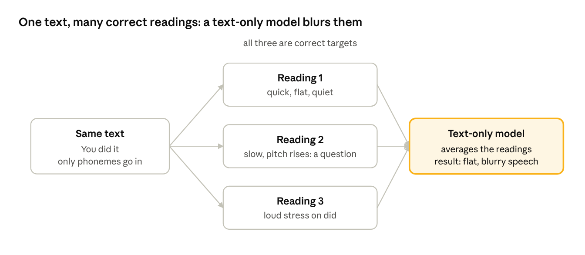

All three readings appear in the training data. The input is identical each time, so the model is penalised for whichever reading it does not produce.

### 3.1 Why this produces flat, blurry speech

This is ordinary regression with a **multimodal target**: one input has several valid answers.

- With mean squared error, the best single answer is the **average** of all valid answers. With mean absolute error (used by FastSpeech 2 for mel frames), it is the **median**. Either way the result is a compromise.
- The average of a rising pitch and a falling pitch is a flat pitch. The average of a loud and a quiet version is medium. The model therefore learns a dull, "robotic" middle voice.
- The paper also notes that the model can **overfit** to the specific variations in the training set. It memorises unusual readings and does not learn a general rule, so it generalises poorly.

### 3.2 The information gap

The paper's key phrase is **information gap**: the input does not contain all the information needed to predict the target. A gap of this kind can be closed in two ways.

1. **Make the target simpler**, so that it has less variety to predict. FastSpeech 1 took this approach (Section 4).

   *FastSpeech 1 in brief:* FastSpeech 1 (Ren et al., NeurIPS 2019, mostly the same authors) was the first widely used non-autoregressive acoustic model. It introduced the FFT blocks and the length regulator, so it produced all mel frames in one pass. Its weak point was that it needed a slow autoregressive "teacher" model for training.

   *Meaning of "simpler target":* the **target** is the answer that the loss compares the model's output with, here the mel-spectrogram it should produce. Normally this is the real recording, which contains much variety, because similar phrases are said with different pitch, speed and loudness. FastSpeech 1 replaced each real mel-spectrogram with the one the **teacher** model generated for the same text. The teacher has already averaged things out, so for a given text it always gives one fairly flat, consistent reading. For example, if real takes end a phrase at 180, 250 or 210 Hz, the teacher gives roughly 210 Hz every time. The student therefore sees one consistent answer per input and finds it easier to learn. The cost is that this answer has lost the lively pitch and loudness, so the student can never sound better than the teacher.
2. **Give the input more information**, so that the model knows which reading to produce. FastSpeech 2 takes this approach (Section 6) by adding duration, pitch and energy as extra inputs.

The paper as a whole is a move from option 1 to option 2.

---

## 4. FastSpeech 1 and Its Limitations

**FastSpeech 1 learned from a teacher model's simplified output. FastSpeech 2 learns from the real recordings and reduces total training time from 53.1 h to 17.0 h.**

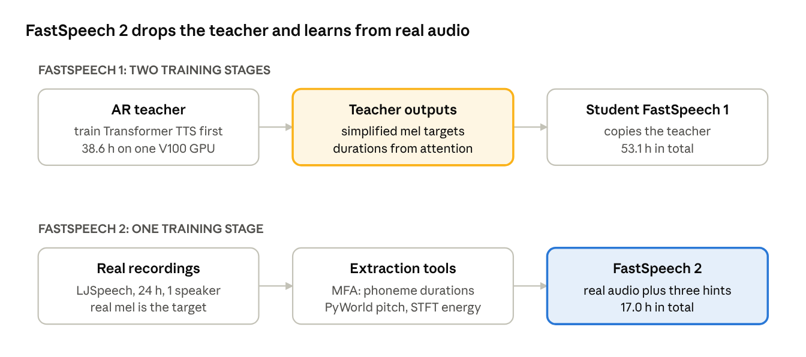

The highlighted middle box is the weak link. Everything the student learns passes through the teacher's outputs first.

### 4.1 How FastSpeech 1 worked

- **Knowledge distillation.** A slow autoregressive model (the **teacher**, here Transformer TTS) is trained first. It is then run over the training text and its output mel-spectrograms are saved. The fast model (the **student**) is trained to copy these outputs and not the real recordings.
- **Reason it helps.** The teacher's outputs are less varied than real speech, because it has already averaged things out. A less varied target means less one-to-many difficulty. This is option 1 from Section 3: simplify the target.
- **Durations from attention.** The teacher's encoder-decoder attention shows which phoneme each output frame was "looking at". Counting the frames per phoneme gives a duration for each phoneme. The student uses these to train its duration predictor.

### 4.2 Three problems

| Problem | What goes wrong | Evidence in the paper |
| --- | --- | --- |
| Complicated pipeline | One model must be fully trained before the next can start | 53.1 h total vs 17.0 h for FastSpeech 2 (Table 2) |
| Information loss | The student can only be as good as the teacher's copy, which has lost pitch and energy variation | Teacher Transformer TTS: MOS 3.72. Real mel through the same vocoder: 3.92 (Table 1) |
| Inaccurate durations | Attention maps are fuzzy, so phoneme boundaries are off | Boundary error 19.68 ms from the teacher vs 12.47 ms from MFA (Table 5a) |

### 4.3 What replaces the teacher

- **Montreal Forced Aligner (MFA).** A forced aligner takes audio plus its transcript and finds where each phoneme starts and ends. "Forced" means the words are already known and only need to be placed in time. The authors trained MFA on their own training set only, with no outside data. MFA is not a neural network. It is a classical statistical model (a hidden Markov model with Gaussian mixture emissions, built on Kaldi) fitted with expectation-maximisation. It is best viewed as a data-preprocessing or labelling tool, like a classical model that produces labels, and not as part of the FastSpeech 2 network. It is fitted once on the training audio and transcripts to produce the duration labels. After that, FastSpeech 2 treats those durations as ordinary supervised targets for its duration predictor. At inference time MFA is not used.
- **Pitch and energy extraction.** Simple signal-processing tools measure pitch (PyWorld) and loudness (from the STFT) for every frame of the real audio. No neural network is needed for these.

FastSpeech 2 therefore obtains its extra inputs by measuring the real audio and not from another model's estimates.

---

## 5. FastSpeech 2 Architecture

### 5.1 Overview (Figure 1a)

**FastSpeech 2 is an acoustic model, the middle layer of a TTS system, and it is the part this paper changes.** The whole pipeline is: text, then phonemes, then [acoustic model: encoder stack → variance adaptor → decoder stack], then mel-spectrogram, then vocoder, then audio. Only the bracketed part is FastSpeech 2. The variance adaptor is the new component. The text front-end and the vocoder are separate components. The diagrams below show the bracketed part in more detail.

The acoustic model has three parts: an **encoder stack**, a **variance adaptor** and a **decoder stack**. Everything except the adaptor is close to a standard Transformer. The paper draws Figure 1a bottom-up. The version below is drawn top-down, with the tensor shape at each step.

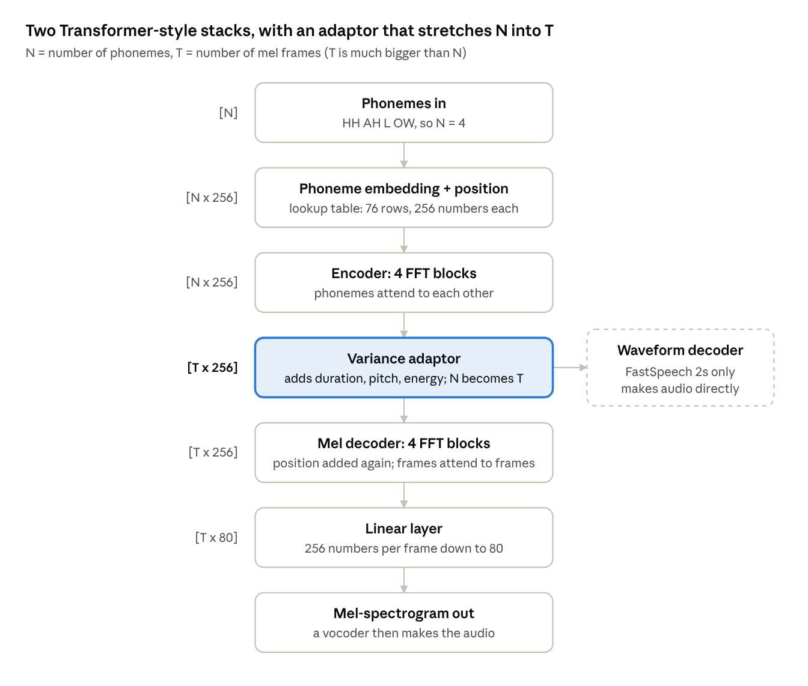

The sequence changes length only at the highlighted adaptor. Everything above it works on N phonemes and everything below it on T frames.

### 5.2 One word through the model

The example word is "hello", with 4 phonemes, spoken over about 0.3 s.

1. **Phonemes in:** 4 integer ids, shape \[4\].
2. **Embedding and position:** each id looks up a 256-number vector. A positional encoding is added so that the model knows the order. Shape \[4 × 256\].
3. **Encoder:** 4 FFT blocks. Each phoneme's vector is updated by attending to the other phonemes, so "L" carries the information that it sits between "AH" and "OW". Shape stays \[4 × 256\].
4. **Variance adaptor:** the duration predictor outputs, for example, \[3, 7, 5, 11\] frames. Each phoneme vector is copied that many times, giving 26 frames. Pitch and energy vectors are added to each frame. Shape \[26 × 256\]. Section 6 covers this in detail.
5. **Mel decoder:** another 4 FFT blocks, now over 26 frames. A new positional encoding is added first, because the frames form a new, longer sequence. Shape \[26 × 256\].
6. **Linear layer:** each 256-number frame is projected to 80 numbers. Shape \[26 × 80\]: the mel-spectrogram.
7. A separate **vocoder** turns the mel-spectrogram into audio. FastSpeech 2s sends the adaptor's output to its own waveform decoder (dashed box, Section 8).

### 5.3 The FFT block

"FFT" here means **Feed-Forward Transformer** and does not mean Fast Fourier Transform. It is a standard Transformer encoder block with one change.

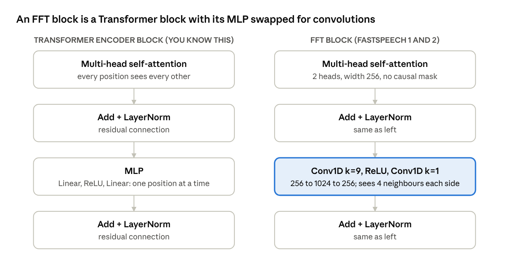

Only the highlighted part differs. Everything else is the standard Transformer block.

- **A 1D convolution is an MLP with a small window.** Consider a row of boxes, one per position, each holding a vector. A standard MLP updates each box using only the contents of that box. A Conv1D with kernel size 9 slides a frame along the row that is 9 boxes wide. At each stop, the box in the middle is updated using its own vector and the 4 boxes on each side of it. The frame then moves one box over and repeats, using the same weights at every stop. If the frame is reduced to 1 box wide, it sees only the box it is centred on, so a kernel-1 convolution is exactly a per-position linear layer.

  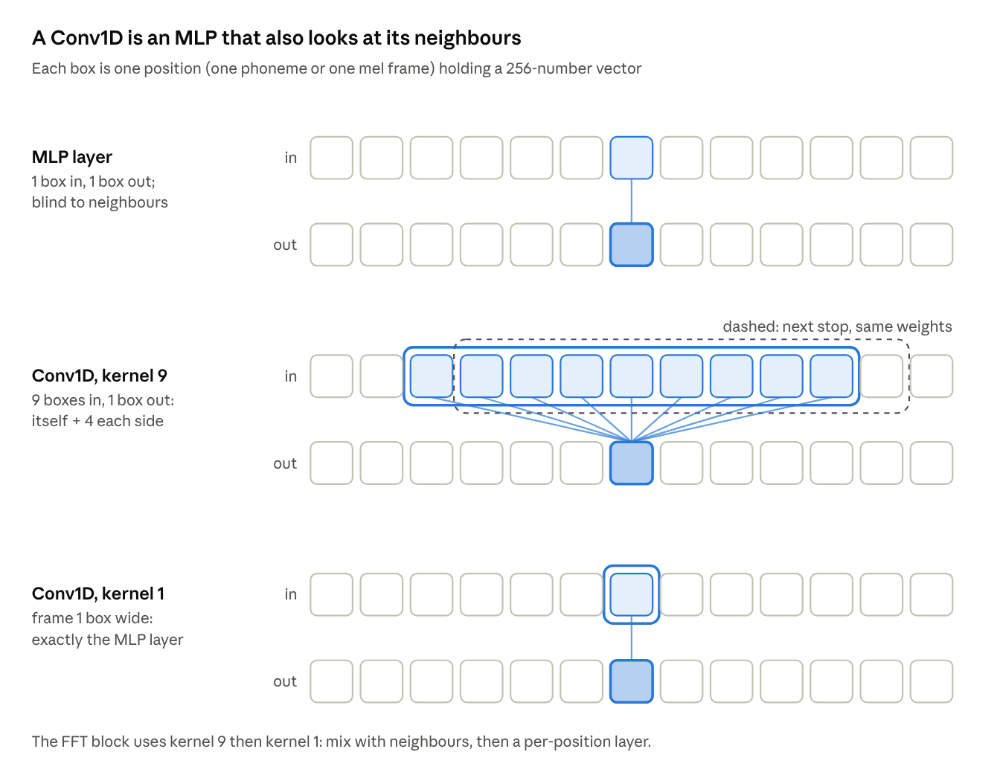

  In each panel, the highlighted boxes on the "in" row are the ones used to compute the highlighted box on the "out" row.
- **Purpose.** Speech changes smoothly: frame 100 sounds very similar to frames 99 and 101. Attention can connect far-apart positions, and the convolution adds a cheap, built-in bias toward local smoothness.
- **The name "decoder" is misleading here.** There is no cross-attention and no causal mask. The mel decoder is a second stack of the same FFT blocks. It is a decoder only in the sense that it produces the output.

| Setting (Table 7) | Value |
| --- | --- |
| Blocks in encoder / decoder | 4 / 4 |
| Hidden width | 256 |
| Attention heads | 2 |
| Conv kernel sizes in each block | 9, then 1 |
| Conv widths | 256 → 1024 → 256 |
| Dropout | 0.1 |
| Total parameters | 27M (FastSpeech 2), 28M (2s) |

---

## 6. The Variance Adaptor

**The variance adaptor closes the information gap by adding three measured properties of the speech (duration, pitch and energy) to the hidden sequence before the decoder receives it.** This is option 2 from Section 3.

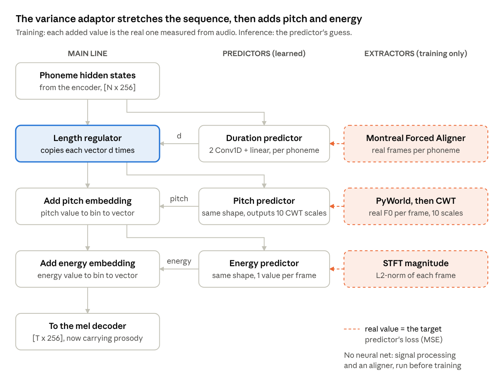

The main line runs down the left. Each predictor reads the main line, makes an estimate, and its value is added back one step lower.

### 6.1 Predictors and extractors

**The three predictors are the only learned parts of the adaptor. During training, fixed extractors supply the real duration, pitch and energy values. At inference the extractors are dropped and the predictors' estimates are used.**

- **Predictors (learned).** There are three: a duration predictor, a pitch predictor and an energy predictor. All three have the same small structure: two 1D convolution layers with ReLU, layer norm and dropout after each, followed by a linear layer that outputs one number. They are neural layers, trained at the same time as the rest of FastSpeech 2.
- **Extractors (training only).** In training, the real values come from extractors: MFA gives the durations, PyWorld gives the pitch and the STFT gives the energy. The same measured values are also the targets on which each predictor is trained.
- **Order of training.** The extractors are not learned models that are trained first and then plugged into the adaptor. MFA is fitted once as a preprocessing step to produce duration labels. PyWorld and the STFT are fixed signal-processing formulas with nothing to train. At inference the extractors are dropped and only the trained predictors run.

Two of the extractor tools are described here, where they are first used.

- **STFT (short-time Fourier transform)** cuts the audio into short, overlapping windows and measures which frequencies are present in each. This gives a picture of how the sound's frequency content changes over time. The mel-spectrogram is built from it, and the energy of a frame is the size (norm) of that frame's STFT magnitudes. A sample output graph is a heatmap with time (frames) on the x-axis and frequency on the y-axis. Brightness shows how strong each frequency is. Vowels appear as bright horizontal bands and silences as dark vertical gaps. Below it, the energy curve is a line with one value per frame, high during loud vowels and near zero in pauses.

  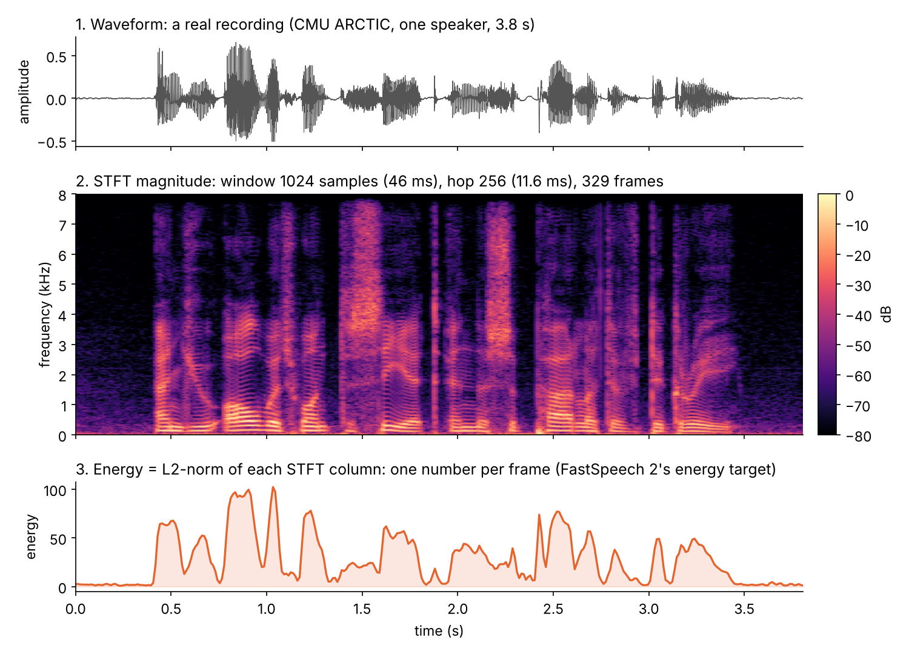

  Real output, computed from a 3.8 s CMU ARCTIC speech recording with FastSpeech 2's settings (1024-sample window, 256-sample hop): the waveform, its STFT magnitude, and the energy curve taken from it.
- **CWT (continuous wavelet transform)** is a related tool used for pitch. Instead of fixed-size windows, it uses stretched and squeezed wave-shaped templates to break a signal into slow and fast changes. The paper uses it to turn the pitch contour into a pitch spectrogram, which is easier for the predictor to learn. It is a calculation and not a trained model. Section 7 covers it in detail. A sample output graph takes as input a pitch contour, a line of F0 in Hz against time frames that rises and falls with the intonation. The output is a heatmap with time on the x-axis and wavelet scale on the y-axis. Slow trends, such as the overall rise of a question, appear in the large-scale rows. Fast local wiggles appear in the small-scale rows.

  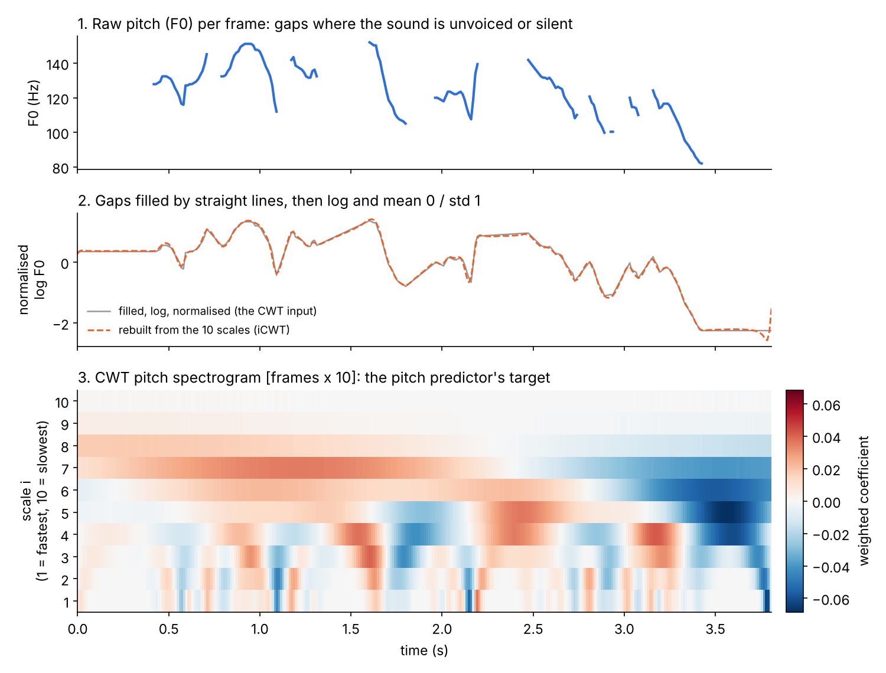

  Real output from the same recording: the raw F0 with its gaps, the filled and normalised log-F0 that goes into the CWT, and the 10-scale CWT pitch spectrogram. The scale widths follow the paper's Equation 1. The dashed orange line is the pitch rebuilt by adding the 10 weighted rows back up (Equation 2). It matches the input almost exactly (correlation 0.998).

### 6.2 Training and inference

- **Training.** The values added to the main line are the **real** ones, measured from the recording (durations from MFA, pitch from PyWorld, energy from the STFT). At the same time, each predictor is trained to estimate those same real values.
- **Inference.** There is no recording, so the predictors' estimates are used.
- **ML analogy: teacher forcing.** In sequence-to-sequence training, the true previous token is fed in and not the model's own estimate. The same idea applies here. Because the decoder always sees correct inputs during training, it learns cleanly "given this pitch and loudness, produce this mel". The one-to-many problem moves out of the decoder and into three small, easy predictors.

### 6.3 The loss function

The training loss is the sum of four parts: mel MAE, plus an MSE loss for each of the duration, pitch and energy predictors.

**Why MAE for the mel and MSE for the predictors?** The paper states which loss each part uses and does not explain the choice. The usual reasoning is as follows.

- **The two losses.** MAE (mean absolute error, also called L1) averages |prediction − target|. MSE (mean squared error, L2) averages (prediction − target)². Squaring makes large errors count much more: an error of 4 costs 4 under MAE and 16 under MSE.
- **What each pulls toward.** When one input has several possible targets (the one-to-many problem from Section 3), MSE pushes the output toward their **mean** and MAE toward their **median**.
- **Mel-spectrogram → MAE.** Each frame has 80 numbers, and a few of them may be far off, for example at a sudden sound or a noisy part of the recording. Under MSE those few would dominate the loss. MAE treats every error in proportion, and a median-like answer is usually less smeared than a mean-like one. Both help prevent a blurry spectrogram.
- **Duration, pitch and energy → MSE.** These are one or a few numbers per position, and they are cleaner targets because the decoder already receives the true values during training. A large miss is the most audible error here, such as a vowel stretched 10 frames too long or a pitch jump in the wrong place. MSE penalises large misses most, and it is the standard choice for this kind of simple regression.
- **Durations are predicted as log values**, so MSE on them penalises relative errors (2 vs 4 frames counts like 10 vs 20) and not raw frame counts.

This reasoning reflects the common view in the TTS literature and is an interpretation. It is not stated in the paper.

### 6.4 Duration and the length regulator

- **What is predicted:** for each phoneme, the number of mel frames it lasts. One frame is about 11.6 ms.
- **Input and output:** the input is the phoneme hidden states before stretching. The output is one number per phoneme.
- **Log domain:** durations range from 1 frame to 30 or more, so the predictor outputs log(duration). This keeps the errors on short and long sounds on a similar scale. At inference the value is converted back to whole frames.
- **Target:** durations from MFA, which are more accurate than FastSpeech 1's attention-based ones (12.47 ms vs 19.68 ms boundary error).
- **Length regulator:** a simple copy operation with no learned weights, borrowed from FastSpeech 1.

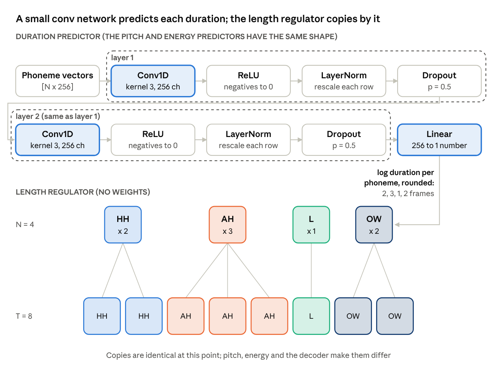

The copy is how a non-autoregressive model knows how many frames to make. It also provides a speed control: multiplying all durations by 1.2 makes the speech 20% slower.

### 6.5 Pitch

- **Definition:** pitch (written **F0**, the fundamental frequency) is the rate at which the vocal folds vibrate. It is low for a deep voice and rises at the end of a question. It carries most of the emotion and intonation.
- **Level:** one pitch value per **frame** and not per phoneme, so the model can represent a rise or fall inside a single vowel.
- **From a number to a vector:** the pitch value is placed into one of **256 bins**, spaced on a log scale (because pitch is heard on a log scale). Each bin has a learned 256-number vector, like a token embedding. That vector is added to the frame.
  - This is equivalent to tokenising pitch: "bin 143" has its own embedding, as a word id does.
- **Difficulty:** pitch varies a great deal, so predicting it directly gives poor results. The paper predicts it in a transformed form (Section 7).

### 6.6 Energy

- **Definition:** the loudness of each frame, computed as the L2-norm of that frame's STFT amplitudes (the size of the frame's frequency vector).
- **From a number to a vector:** 256 bins, spaced **evenly** in this case, then an embedding added to the frame, as for pitch.
- **Detail:** the energy predictor is trained to output the raw energy value and not the bin. The authors applied the pitch method (Section 7) to energy and saw no gain, because energy varies less.

### 6.7 Inside each predictor (Figure 1c)

Figure 1c shows the layers inside a single predictor. It is the second of the two diagrams referred to by Figures 1b and 1c. All three predictors have the same shape, with separate weights:

1. Conv1D, kernel 3, 256 channels, then ReLU
2. LayerNorm, then dropout 0.5
3. Conv1D, kernel 3, 256 channels, then ReLU
4. LayerNorm, then dropout 0.5
5. Linear layer: 256 numbers down to 1 number per position

In MLP terms, this is a 2-layer network applied at every position, where each layer also looks at one neighbour on each side. The heavy dropout (0.5) prevents these small networks from memorising the data.

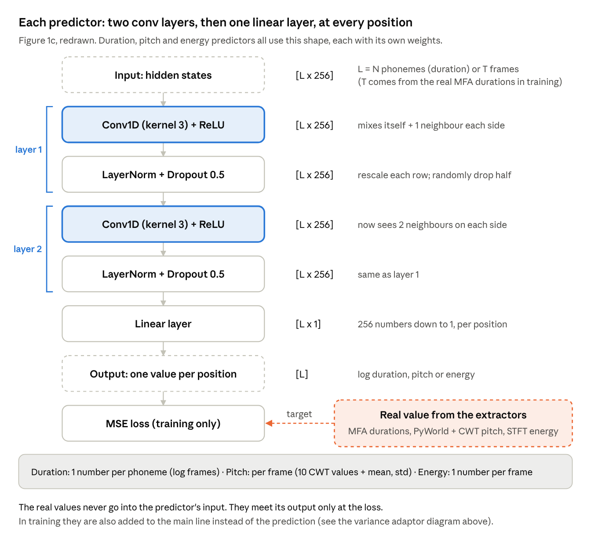

The diagram reads top to bottom. The length L never changes inside the predictor. Only the width shrinks from 256 to 1 at the end. The two highlighted convolutions are the only places where neighbouring positions mix.

---

## 7. Pitch Prediction with the Wavelet Transform

**Instead of predicting one jumpy pitch curve, the model predicts 10 smoother curves at different time scales and adds them back together. This keeps the pitch lively and avoids a flat result.** Removing this method reduces the pitch spread from 54.1 to 42.3 (real speech: 54.4). The method is described in Appendix C and Figure 2 of the paper.

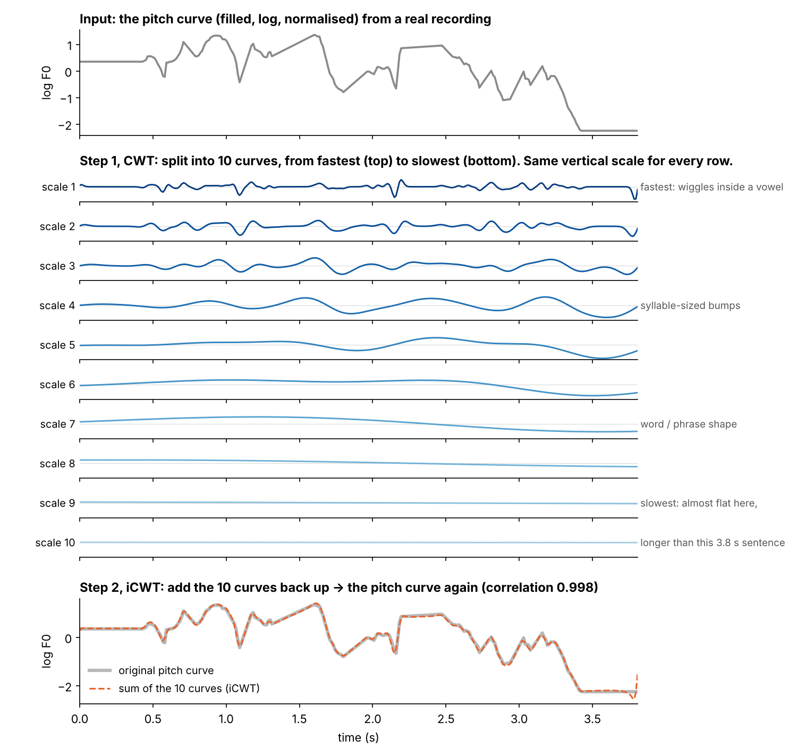

A sample output, computed from a real 3.8 s speech recording. **Top:** the pitch curve. **Middle:** the same curve split by the CWT into 10 curves, from fast wiggles (scale 1) to slow drift (scale 10). All rows use one vertical scale, so their sizes can be compared. Scales 9 and 10 are nearly flat because they are slower than this whole sentence. **Bottom:** adding the 10 curves back up gives the original pitch again. These 10 rows are what the pitch predictor learns to output.

### 7.1 The idea

A pitch curve mixes slow and fast movements at once:

- **Slow:** the whole sentence drifts down, or rises at the end of a question.
- **Medium:** each word has a small bump of stress.
- **Fast:** tiny wobbles inside a single vowel.

A **continuous wavelet transform (CWT)** separates these. It slides a small bump-shaped template (the **Mexican hat wavelet**) along the curve at 10 different widths and records how well the curve matches the bump at each moment. Narrow bumps capture fast wiggles and wide bumps capture slow drifts.

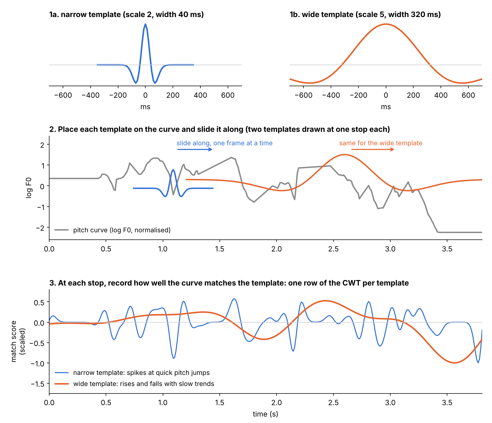

The CWT applied to the same real recording. **1:** two of the 10 templates, a narrow one and a wide one. Both have the Mexican hat shape, stretched to different widths taken from Equation 1. **2:** each template is laid on the pitch curve and slid along, one frame at a time. **3:** at every stop the match score is recorded. The narrow template's scores jump at quick pitch changes and the wide template's scores follow the slow rise and fall of the sentence. Each template gives one row of the 10-row pitch spectrogram. Like a Conv1D, this is one fixed kernel slid along a sequence, but nothing in it is learned.

The result is a **pitch spectrogram** of shape \[T × 10\], one row per frame and one column per scale. It is the same idea as a mel-spectrogram, applied to the pitch curve and not to the sound wave.

- **Fourier vs wavelet:** a Fourier transform shows which wiggle speeds exist in the whole signal. A wavelet transform also shows *when* each one occurs, which matters because a question's rise happens only at the end.

### 7.2 Why this helps the model

As stated in Section 3, when a target is uncertain an MSE-trained model outputs the average. On a raw pitch curve that average is close to flat.

When the curve is split into scales, the slow components are fairly predictable from the text (sentence type, word stress). The model therefore gets them right even when the fast detail is uncertain. Summing the scales back preserves that large-scale shape.

### 7.3 The pipeline

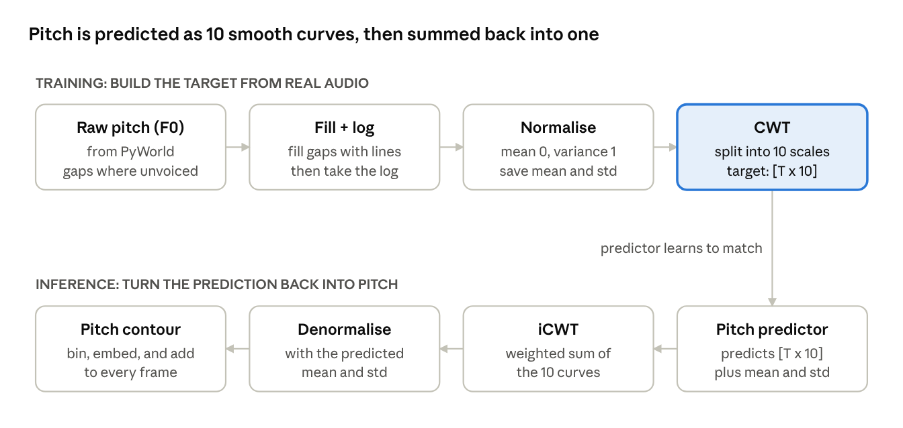

The top row runs during training only and the bottom row runs at inference.

- **Fill the gaps.** Pitch exists only when the vocal folds vibrate (voiced sounds). On sounds such as "s" or "f", and in silences, there is no pitch, so the curve has holes. The CWT fails on holes, so they are filled by drawing straight lines across them.
- **Log, then normalise.** Taking the log matches how pitch is heard. Normalising each sentence to mean 0 and variance 1 removes the speaker's overall voice height, so the CWT sees only the shape. The mean and standard deviation are stored, because the model must predict them too.
- **Predicting mean and std.** The predictor averages its hidden states over all frames into one vector, then a linear layer outputs the mean and std. This is the same as **mean pooling** before a classification head.
- **Loss:** MSE on the 10-column pitch spectrogram, and on the mean and std.

### 7.4 The two formulas

The 10 scales use widths that double each time (Equation 1):

$$W_i(t) = W(2^{i+1}\tau_0,\; t)\,(i + 2.5)^{-5/2}, \qquad i = 1, \dots, 10,\; \tau_0 = 5\,\text{ms}$$

The widths are therefore 20 ms, 40 ms, 80 ms, and so on up to about 10 s. Each is twice as wide as the one before.

To recover the pitch, the model adds the 10 predicted curves with fixed weights (Equation 2):

$$\hat{F}_0(t) = \sum_{i=1}^{10} \hat{W}_i(t)\,(i + 2.5)^{-5/2}$$

This is a weighted sum, with weights that shrink as the scale gets wider. No learning happens in this step. For this reason the paper describes the inverse transform (iCWT) as a fixed, cheap operation.

---

## 8. FastSpeech 2s: Direct Waveform Generation

**FastSpeech 2s removes the separate vocoder and outputs the waveform directly. It is the fastest system in the paper (51.8× faster than Transformer TTS) but sounds slightly worse than FastSpeech 2 (MOS 3.71 vs 3.83).** The paper describes it as the first fully parallel phoneme-to-waveform model (Figures 1a and 1d).

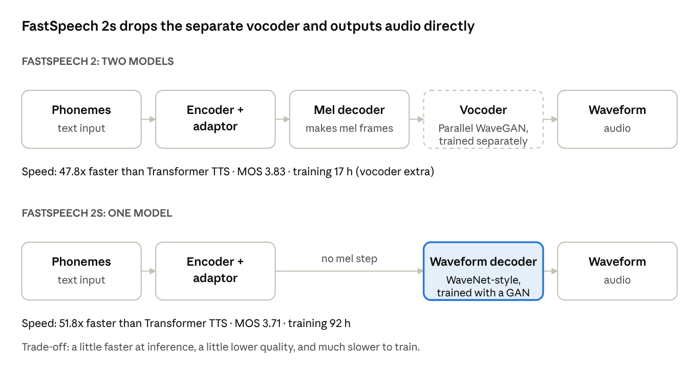

The top pipeline needs two separately trained models joined by a mel-spectrogram. The bottom one replaces the mel decoder and vocoder with a single waveform decoder (highlighted).

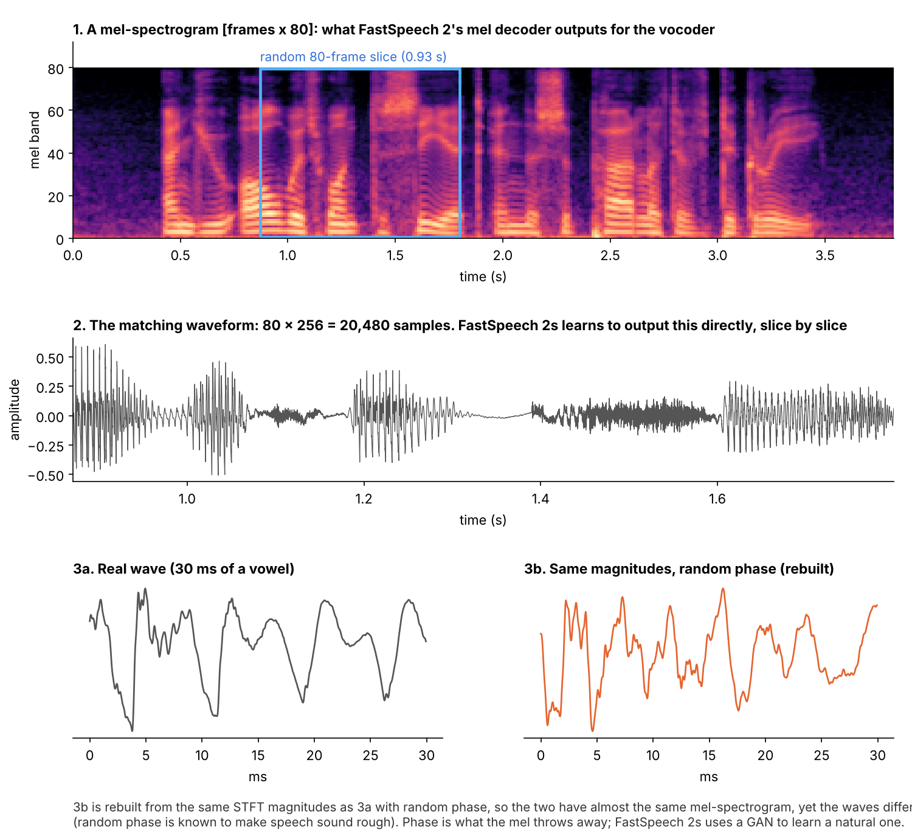

Sample outputs from the same real recording, computed with signal processing. These are not FastSpeech 2 or 2s model outputs. **1:** the mel-spectrogram, the hand-off point in the two-model pipeline. The blue box marks an 80-frame slice, the size FastSpeech 2s trains on. **2:** the 20,480 audio samples that match that slice, which FastSpeech 2s's waveform decoder must produce directly. **3:** why this is hard. Rebuilding the wave from the same magnitudes with random phase gives a very different wave, so the mel alone does not fix the waveform. This is why 2s needs a GAN.

### 8.1 Two problems with direct audio generation

1. **Phase.** A mel-spectrogram keeps only the amount of energy at each frequency. A waveform also needs the exact timing of each wave's peaks (the **phase**). Phase looks almost random, so a predictor with an MSE loss cannot learn it well.
2. **Length.** A 10-second sentence is 220,500 samples. That does not fit in GPU memory for training. The model can therefore only train on short clips, and a short clip shows only a few phonemes, which is poor for learning the text.

### 8.2 The two solutions

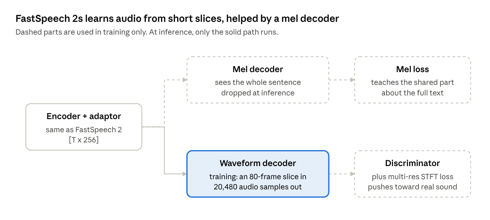

Only the highlighted waveform decoder is new. The dashed mel decoder is a training aid.

#### The waveform decoder

The waveform decoder is the part of FastSpeech 2s that turns the adaptor's hidden vectors directly into audio samples. In FastSpeech 2 that job takes two steps: the mel decoder makes a mel-spectrogram, then a separate vocoder turns it into sound. The waveform decoder performs both steps in one network, inside the same model. In one line: waveform decoder = mel decoder + vocoder merged into one, trained together with the rest of the model.

- **Input:** the variance adaptor's output, one 256-number vector per frame, \[T × 256\]. This is the same input the mel decoder receives.
- **Output:** one number per audio sample, 256 samples per frame, so \[T × 256\] becomes about 256 × T numbers. For an 80-frame training slice that is 20,480 samples.
- **Lengthening:** a **transposed convolution** stretches the sequence by 256 times, so each frame becomes 256 positions, one per sample. It is the reverse of a strided convolution, which shrinks a sequence.
- **Adding detail:** 30 WaveNet-style residual blocks with dilated convolutions and gated activations. They shape each sample using its neighbours, near and far.
- **Training:** with a GAN discriminator plus a multi-resolution STFT loss, and not only MSE. This allows it to learn a natural phase.

##### WaveNet

WaveNet (DeepMind, van den Oord et al., 2016) was the first neural network to generate raw audio that sounded close to a real human voice. It can be described as **GPT for audio samples, built from convolutions in place of attention**: it predicts the next audio sample from all the samples before it, one at a time. Three ideas from it are reused here:

- **Dilated convolutions:** kernels with gaps that double layer by layer, so the network can see far back without many weights (the bottom of the Figure 1d diagram below).
- **Gated activation:** tanh(x) × sigmoid(x), where the sigmoid acts as a 0-to-1 gate on the signal, like in an LSTM.
- **Residual and skip connections:** each block adds its output back to its input, and also sends a copy straight to the final output.

Original WaveNet is **slow** because it makes 22,050 sequential predictions for each second of audio. It was later used as the vocoder in Tacotron 2. FastSpeech 2s keeps only its **block design**. Its convolutions are non-causal and all samples are made in one parallel pass, so it is not autoregressive. "WaveNet-style" here therefore means "built from WaveNet's blocks" and does not mean "generates like WaveNet".

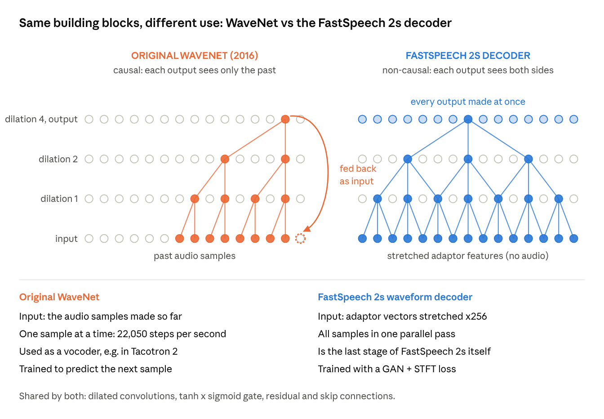

Left: original WaveNet only looks backwards, and each new sample is fed back in before the next one can be made. Right: FastSpeech 2s uses the same kind of dilated stack, but looks both ways, starts from the adaptor's features and not from past audio, and fills in every sample at once.

##### Inside the waveform decoder (Figure 1d)

The decoder follows **WaveNet**. Bottom to top:

1. **Transposed Conv1D: stretch.** A transposed convolution is a learned upsampling layer that makes a sequence longer. Each mel frame covers 256 audio samples, so the sequence is stretched to audio length.
2. **30 residual blocks, each with:**
   - **Dilated Conv1D (kernel 3).** A convolution with gaps between the taps. Dilation 1 looks at neighbours 1 apart, dilation 2 looks 2 apart, then 4, 8, and so on. The view widens quickly without adding many weights.
   - **Gated activation.** Two parallel outputs, one through tanh and one through sigmoid, multiplied together. The sigmoid acts as a 0-to-1 gate on the tanh signal, like a gate in an LSTM.
   - **Conv 1×1.** A per-position linear layer, as in the FFT block. A 64-channel skip connection runs from each block to the output.
3. **Conv1D: output** one number per audio sample.

All convolutions are **non-causal**: they look at past and future samples. This is possible because the whole sequence is produced at once.

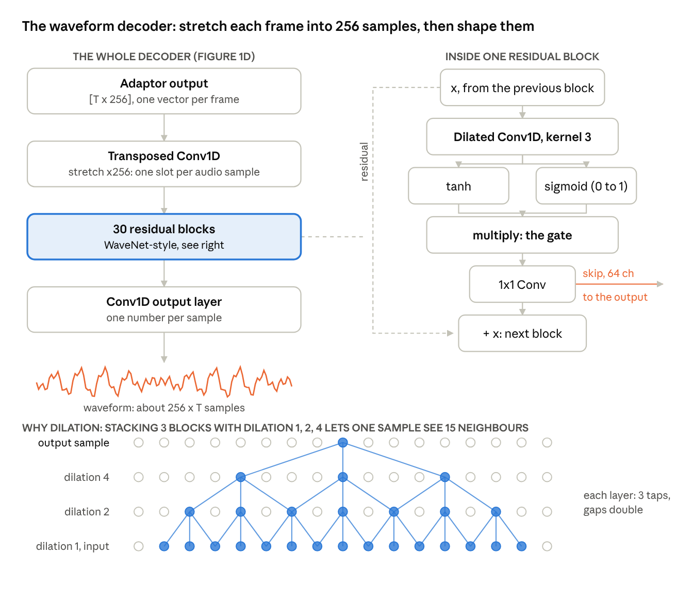

Left: the whole decoder, top to bottom. Right: what happens inside each of the 30 highlighted blocks. Bottom: why dilated convolutions help. With gaps that double at each layer, a few small kernels can reach far along the waveform. The dilation pattern drawn (1, 2, 4) is the usual WaveNet pattern, used to illustrate. The paper does not list its exact dilations.

#### Solution for phase: a GAN

A second network, the **discriminator**, looks at audio and judges "real or generated". The waveform decoder is trained to fool it. A realistic phase is part of sounding real, so the decoder learns it without any direct phase prediction. The discriminator is copied from Parallel WaveGAN: 10 layers of dilated 1D convolutions with leaky ReLU, trained with the **LSGAN** loss (the GAN loss written as squared error).

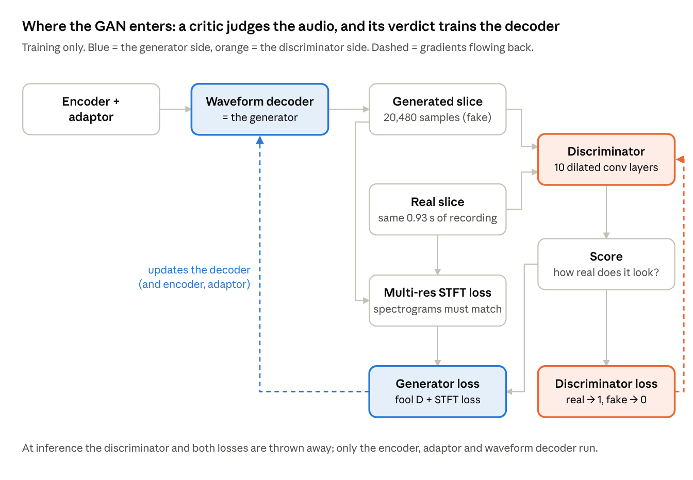

The two players take turns. The **discriminator** is updated to score real slices near 1 and generated ones near 0. The **waveform decoder** is updated to push its own score toward 1, while the STFT loss keeps its spectrogram close to the real one. In LSGAN form, both losses are squared distances from those targets.

A second loss is the **multi-resolution STFT loss**. The generated clip and the real clip are both turned into spectrograms at several window sizes, and the differences are penalised. This prevents the GAN from drifting into realistic-sounding nonsense.

##### WaveGAN and Parallel WaveGAN

- **WaveGAN** (Donahue, McAuley and Puckette, 2019) is an early GAN for raw audio. It makes short sound clips, such as single spoken digits or drum hits, from **random noise only**. It takes no text or mel input, so it cannot read out a sentence. It is not used anywhere in FastSpeech 2.
- **Parallel WaveGAN** (Yamamoto, Song and Kim, 2020) is a **vocoder**: it turns a mel-spectrogram into a waveform. Its generator is a WaveNet-style stack of non-causal dilated convolution blocks, fed the mel (stretched to sample length) plus random noise. All samples are made at once, so it is fast. It is trained with two losses: a **multi-resolution STFT loss**, which makes its spectrograms match the real ones, and an **adversarial (LSGAN) loss** from a 10-layer dilated-conv discriminator. "Parallel" is in the name because, unlike the original WaveNet, it does not generate one sample at a time.
- **Use 1 in this paper:** a pre-trained Parallel WaveGAN is the vocoder that turns the mel output of FastSpeech 2, and of every baseline, into audio. Because all systems share it, the listening tests compare only the acoustic models.
- **Use 2 in this paper:** FastSpeech 2s takes Parallel WaveGAN's ideas inside the model. Its waveform decoder is built the same way as the Parallel WaveGAN generator, but it is fed the adaptor's hidden states and not a mel-spectrogram. It also reuses the same discriminator and the same multi-resolution STFT loss.

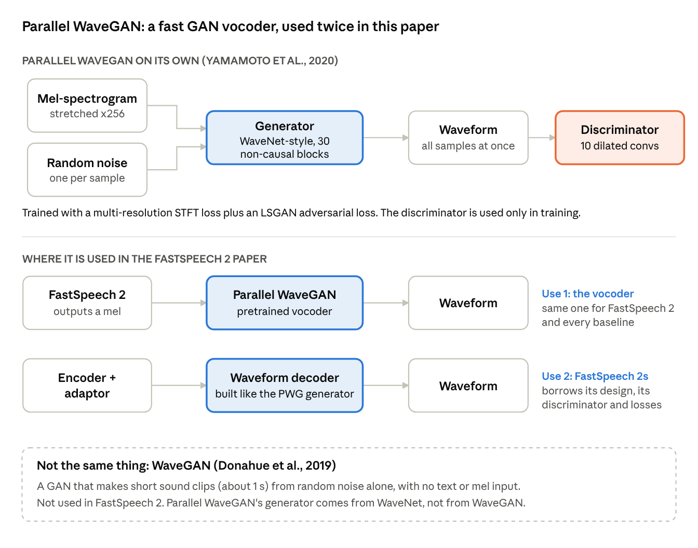

Top: Parallel WaveGAN on its own. Bottom: its two roles in this paper, first as a separate vocoder and then as the blueprint for FastSpeech 2s's built-in decoder. The dashed box at the bottom separates it from the similarly named WaveGAN.

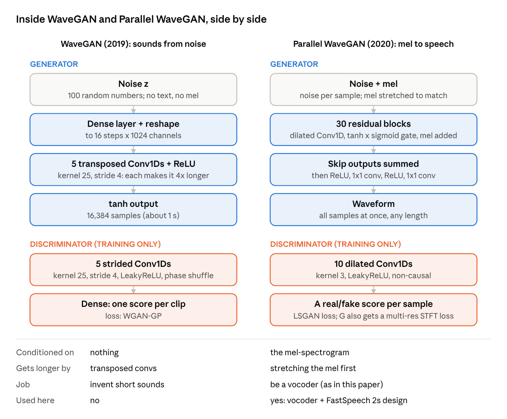

Each column reads top to bottom: blue is the generator and orange the discriminator. The key difference is the first box. WaveGAN starts from noise alone, so it can only invent sounds. Parallel WaveGAN also receives the mel-spectrogram, so it can reproduce what the mel describes. Layer details are from the two original papers (Donahue et al. 2019, Yamamoto et al. 2020) and not from the FastSpeech 2 paper.

#### Solution for length: keep the mel decoder during training

The waveform decoder sees only a random slice of 80 frames (20,480 samples, about 0.93 s). The mel decoder still sees the whole sentence, and its loss trains the shared encoder and adaptor on full text. At inference the mel decoder is discarded. Removing it during training costs 0.285 CMOS, so it matters.

### 8.3 Cost of 2s

FastSpeech 2s is much slower to train: 600k steps on 2 GPUs (92 hours), vs 160k steps on 1 GPU (17 hours) for FastSpeech 2. FastSpeech 2's 17 hours exclude the vocoder, which was trained separately.

---

## 9. Experiments and Results

**On the LJSpeech dataset, FastSpeech 2 sounds better than every other model tested, trains in a third of FastSpeech 1's time, and generates speech about 48× faster than an autoregressive model.**

### 9.1 Setup

- **Data:** LJSpeech, one female English speaker, 13,100 clips (about 24 hours). Split: 12,228 train, 349 validation, 523 test.
- **Training:** 1 V100 GPU, batch of 48 sentences, Adam optimiser, 160k steps.
- **Vocoder:** a pre-trained Parallel WaveGAN, the same for every system, so only the acoustic models differ.

### 9.2 Metrics

| Metric | What it measures | Better is |
| --- | --- | --- |
| **MOS** (mean opinion score) | Listeners rate each clip from 1 (bad) to 5 (excellent), and scores are averaged | Higher |
| **CMOS** (comparative MOS) | Listeners hear two clips side by side and say which is better and by how much. 0 = the baseline | Higher. Negative means worse than the baseline |
| **RTF** (real-time factor) | Seconds of compute to make 1 second of audio | Lower |
| **σ, γ, K** | Spread, lopsidedness and tail-heaviness of the pitch values (standard deviation, skewness, kurtosis) | Closer to the real recordings |
| **DTW distance** | How far the generated pitch curve is from the real one, after lining them up in time (dynamic time warping) | Lower |
| **MAE** | Average absolute error, here on frame energy | Lower |

### 9.3 Audio quality (Table 1)

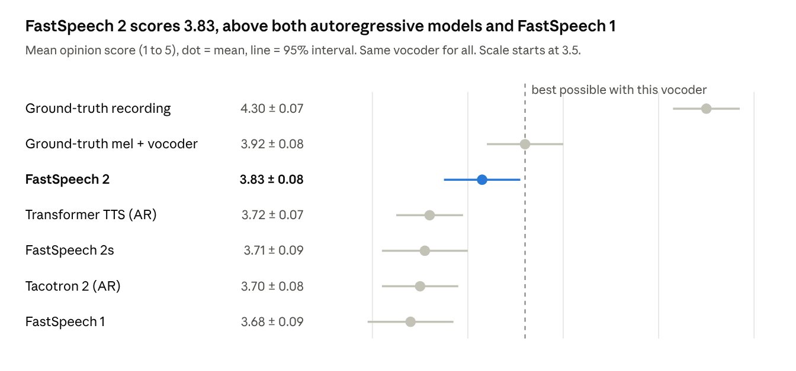

The real recording scores 4.30, but passing even the real mel through the vocoder drops it to 3.92. That 3.92 is the ceiling for any acoustic model in this test. FastSpeech 2 gets within 0.09 of it.

The confidence intervals overlap for most models, so small gaps (3.72 vs 3.71) are not meaningful. The side-by-side CMOS test is sharper: FastSpeech 1 scores −0.885 and Transformer TTS −0.235 against FastSpeech 2.

### 9.4 Speed (Table 2)

| System | Training time (h) | Inference RTF | Speed-up vs Transformer TTS |
| --- | --- | --- | --- |
| Transformer TTS (AR) | 38.64 | 0.932 | 1× |
| FastSpeech 1 (incl. teacher) | 53.12 | 0.0192 | 48.5× |
| **FastSpeech 2** | **17.02** | 0.0195 | 47.8× |
| FastSpeech 2s | 92.18 | **0.0180** | **51.8×** |

- An RTF of 0.0195 means 1 second of speech takes about 20 ms to generate.
- FastSpeech 2's training is 3.12× shorter than FastSpeech 1's, because there is no teacher to train first.
- Inference speed is about the same as FastSpeech 1, since both are non-autoregressive. FastSpeech 2s is fastest because it skips the vocoder.

### 9.5 Pitch naturalness (Table 3)

| System | σ (spread) | γ (skew) | K (kurtosis) | DTW (lower is better) |
| --- | --- | --- | --- | --- |
| Real recordings | 54.4 | 0.836 | 0.977 | — |
| Tacotron 2 | 44.1 | 1.28 | 1.311 | 26.32 |
| Transformer TTS | 40.8 | 0.703 | 1.419 | 24.40 |
| FastSpeech 1 | 50.8 | 0.724 | −0.041 | 24.89 |
| **FastSpeech 2** | **54.1** | **0.881** | **0.996** | 24.39 |
| FastSpeech 2 without CWT | 42.3 | 0.771 | 1.115 | 25.13 |
| FastSpeech 2s | 53.9 | 0.872 | 0.998 | **24.37** |

The goal is to match the real column, and larger or smaller numbers are not better in themselves. FastSpeech 2's pitch spread (54.1) almost equals real speech (54.4), so its pitch moves as much as a human's. The autoregressive models sit at 40 to 44, which indicates flatter, more monotone pitch. Figure 3 in the paper shows the same effect: FastSpeech 2's pitch curve has the tall jumps of the real one, and FastSpeech 1's is flatter.

### 9.6 Energy and duration (Tables 4 and 5)

- **Energy MAE** falls from 0.142 (FastSpeech 1) to 0.131 (FastSpeech 2) and 0.133 (2s), so loudness tracks the real audio more closely.
- **Duration accuracy:** on 50 hand-aligned clips, MFA's phoneme boundaries are off by 12.47 ms on average vs 19.68 ms for the teacher's attention. Giving FastSpeech 1 the MFA durations alone improves it by +0.195 CMOS. Better durations therefore help before any pitch or energy is added.

---

## 10. Ablations, Control and Limitations

### 10.1 Ablations (Table 6)

**Pitch is the most important input. Removing it costs FastSpeech 2 −0.245 CMOS and FastSpeech 2s −1.130.** An ablation study removes one component at a time and measures the drop. CMOS is relative to the full model, so 0 is the full model and more negative is worse.

| Setting | FastSpeech 2 (CMOS) | FastSpeech 2s (CMOS) |
| --- | --- | --- |
| Full model | 0 | 0 |
| Without energy | −0.040 | −0.160 |
| Without pitch | −0.245 | −1.130 |
| Without pitch and energy | −0.370 | −1.355 |

Other ablations in the paper:

- **Pitch predicted directly, without CWT:** −0.185 (FastSpeech 2) and −0.201 (2s). Pitch also becomes flatter (σ 42.3 vs 54.1, Table 3).
- **FastSpeech 2s without the helper mel decoder:** −0.285.
- **Duration** is not ablated, because without it the model cannot decide how many frames to output.

A likely reading of why 2s suffers more without pitch is that 2s must also generate the fine waveform detail, so it depends more on every input it receives. This is an interpretation and is not stated by the authors.

### 10.2 Control (Appendix E)

Because duration, pitch and energy are explicit inputs, they can be edited at inference:

- **Pitch:** the authors multiply the predicted pitch curve by 0.75 and by 1.50 and still obtain clean mel-spectrograms (Figure 4). In the figure, the horizontal stripes (the **harmonics** of the voice) squeeze together for 0.75× and spread apart for 1.50×.
- **Duration:** scaling all durations changes the speaking speed.
- **Energy:** scaling it changes the loudness.

These are controls that end-to-end models such as [Fish Audio](https://github.com/fishaudio/fish-speech) do not expose directly. Fish Audio (Fish Speech) is an open-source TTS system with voice cloning. Its design is based on transformer language models that operate on discrete audio tokens. It generates prosody implicitly and does not use separate duration, pitch and energy inputs.

### 10.3 Limitations stated by the authors

- **External tools.** Quality depends on MFA for durations and PyWorld for pitch. The authors want a future version with no outside aligner.
- **One speaker, three inputs.** The experiments use only LJSpeech. Emotion, speaking style and speaker identity are named as future additions to the adaptor.

### 10.4 A further limitation

The one-to-many problem does not disappear. It moves. The decoder is now well conditioned, because it always receives the true inputs. The **predictors** still see only text, and they are still trained with MSE. At inference they therefore predict an averaged, "typical" pitch and duration for the sentence. This is why FastSpeech 2 sounds natural but not very expressive: nothing in the input indicates that the speaker is excited, sarcastic or tired. This is an interpretation and is not stated by the authors.

### 10.5 Relevance to prosody research

- **Prosody becomes measurable.** Pitch, energy and duration are real numbers per frame or phoneme. They can be plotted, compared across contexts, and checked against the model's output.
- **A clean place to add context.** To make speech vary with the situation, the predictors are the natural place for extra input (dialogue history, a style vector). The decoder already knows how to turn these inputs into sound.
- **Contrast with Fish Audio.** Fish Audio learns prosody implicitly, inside a language model over audio tokens. FastSpeech 2 makes it explicit. Comparing the two helps to identify which parts of "behaviour" reduce to pitch, energy and timing.

---

## 11. Glossary

| Term | Plain meaning |
| --- | --- |
| TTS | Text to speech |
| Phoneme | A basic speech sound, and the model's input token |
| G2P | Grapheme-to-phoneme: a tool that turns spelling into phonemes |
| Waveform | The raw audio: air pressure values, 22,050 per second here |
| Mel-spectrogram | A \[frames × 80\] picture of how much energy is at each pitch band over time |
| Frame | One column of the mel-spectrogram, about 11.6 ms of audio |
| Vocoder | A network that turns a mel-spectrogram into a waveform |
| Autoregressive (AR) | Generates one step at a time, each step using the previous ones |
| Non-autoregressive (NAR) | Generates every step in one parallel pass |
| One-to-many mapping | One input with many valid outputs |
| Information gap | Information the output needs that the input lacks |
| Knowledge distillation | Training a student model on a teacher model's outputs |
| Forced alignment / MFA | Finding where each known phoneme starts and ends in a recording |
| Prosody | How something is said: rhythm, pitch, stress, loudness |
| Pitch / F0 | How high the voice is, set by the vocal folds' vibration rate |
| Energy | Loudness of a frame |
| Variance adaptor | The block that adds duration, pitch and energy to the hidden sequence |
| Length regulator | Copies each phoneme vector by its duration to reach frame length |
| FFT block | Feed-Forward Transformer block: self-attention + two 1D convolutions |
| Conv1D | A layer that mixes each position with a small window of neighbours |
| CWT / iCWT | Continuous wavelet transform and its inverse: split a curve into time scales, and add them back |
| Phase | The exact timing of each wave's peaks, lost in a mel-spectrogram |
| GAN | Generator trained against a discriminator that judges real vs fake |
| STFT | Short-time Fourier transform: frequency content of short overlapping windows |
| MOS / CMOS | Listener quality scores: absolute (1–5) and side-by-side comparison |
| RTF | Real-time factor: compute seconds per second of audio |
| Ablation | Removing one part to see how much it mattered |

---

## 12. Sources

- Ren, Y., Hu, C., Tan, X., Qin, T., Zhao, S., Zhao, Z., Liu, T.-Y. (2021). *FastSpeech 2: Fast and High-Quality End-to-End Text to Speech.* ICLR 2021. [arXiv:2006.04558](https://arxiv.org/abs/2006.04558) ([PDF](https://arxiv.org/pdf/2006.04558)). Every number in this note is taken from this paper.
- [Audio samples from the authors](https://speechresearch.github.io/fastspeech2/). Samples of FastSpeech 2 and 2s alongside the baselines.

**Related papers cited in this note**

- Ren, Y., Ruan, Y., Tan, X., Qin, T., Zhao, S., Zhao, Z., Liu, T.-Y. (2019). *FastSpeech: Fast, Robust and Controllable Text to Speech.* NeurIPS 2019. [arXiv:1905.09263](https://arxiv.org/abs/1905.09263)
- Li, N., Liu, S., Liu, Y., Zhao, S., Liu, M., Zhou, M. (2019). *Neural Speech Synthesis with Transformer Network* (Transformer TTS). AAAI 2019. [arXiv:1809.08895](https://arxiv.org/abs/1809.08895)
- Shen, J., et al. (2018). *Natural TTS Synthesis by Conditioning WaveNet on Mel Spectrogram Predictions* (Tacotron 2). ICASSP 2018. [arXiv:1712.05884](https://arxiv.org/abs/1712.05884)
- van den Oord, A., et al. (2016). *WaveNet: A Generative Model for Raw Audio.* [arXiv:1609.03499](https://arxiv.org/abs/1609.03499)
- Yamamoto, R., Song, E., Kim, J.-M. (2020). *Parallel WaveGAN: A Fast Waveform Generation Model Based on Generative Adversarial Networks with Multi-Resolution Spectrogram.* ICASSP 2020. [arXiv:1910.11480](https://arxiv.org/abs/1910.11480)
- Donahue, C., McAuley, J., Puckette, M. (2019). *Adversarial Audio Synthesis* (WaveGAN). ICLR 2019. [arXiv:1802.04208](https://arxiv.org/abs/1802.04208)
- Mao, X., Li, Q., Xie, H., Lau, R. Y. K., Wang, Z., Smolley, S. P. (2017). *Least Squares Generative Adversarial Networks* (LSGAN). ICCV 2017. [arXiv:1611.04076](https://arxiv.org/abs/1611.04076)
- McAuliffe, M., Socolof, M., Mihuc, S., Wagner, M., Sonderegger, M. (2017). *Montreal Forced Aligner: Trainable Text-Speech Alignment Using Kaldi.* Interspeech 2017, pp. 498-502. [ISCA Archive](https://www.isca-archive.org/interspeech_2017/mcauliffe17_interspeech.html)

**Notes on provenance.** All diagrams are simplified redraws of the paper's figures. The teacher-forcing, mean-pooling and "tokenising pitch" comparisons are teaching analogies and are not claims from the paper. The reasoning for the loss choices (Section 6.3), the explanation of why 2s suffers more without pitch (Section 10.1) and the further limitation in Section 10.4 are interpretations and are not statements by the authors.
